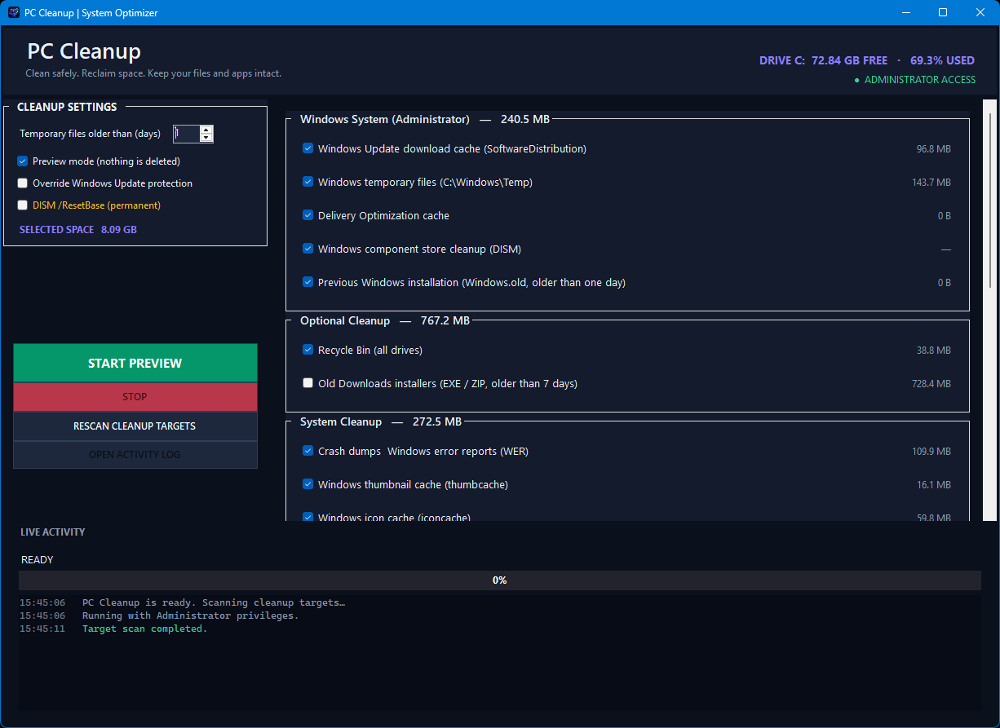

# 🧹 PC Cleanup

**A lightweight Windows utility to review and safely clean temporary files and regenerable caches.**


PC Cleanup gives you control over what gets scanned and removed. Review cleanup targets, preview the results without deleting anything, then run a cleanup with live progress and a detailed operation log.

## 🖥️ Application preview



## ✨ Features

- ☑️ **Selective cleanup** — choose individual targets with a clear checkbox-based interface.
- 🔎 **Scan before action** — inspect selected locations and estimate recoverable space.
- 👀 **Safe preview** — preview proposed deletions without removing files.
- 📊 **Live feedback** — follow progress, percentage, current operation, and timestamped logs.
- 🛡️ **Safety protections** — skip locked files, avoid filesystem reparse points, and protect Windows Update data when update activity is detected.
- 🧰 **Broad cache coverage** — clean temporary files, developer and application caches, and selected Windows system caches.
- 🔐 **Administrator actions** — clearly group privileged Windows operations and provide a visible restart-as-admin action alongside them.

## 🗂️ Cleanup categories

| Category | Examples |
| --- | --- |
| Temporary files | User temporary files older than the selected age |
| Developer caches | uv, pip, npm/npx, Pub, Dart, Yarn, pnpm, bun, Maven and Gradle |
| Application caches | Electron updater caches, application cache folders, Chromium-based browser caches |
| System caches | Crash dumps, Windows Error Reporting, thumbnails, icon and GPU shader caches, web and Direct3D caches |
| Optional cleanup | Recycle Bin and old EXE/ZIP installers in Downloads |
| Windows (Administrator) | Windows Update download cache, Windows Temp, Delivery Optimization, DISM component cleanup and Windows.old |

Some optional and administrator-only operations are unchecked or unavailable by default. Review every selected target before starting a live cleanup.

## 🛡️ Safety first

1. **Run Preview first.** Preview mode does not delete files.
2. Review the selected targets and the confirmation dialog before live cleanup.
3. Close applications before clearing their caches. Locked or inaccessible files may be skipped.
4. Windows Update downloads are protected when update activity or a pending restart is detected. Low-disk protection can also skip Windows-level cleanup.
5. **Force Windows Update** overrides update-activity protection. Enable it only when you understand the consequences.
6. **DISM ResetBase** permanently removes the ability to uninstall currently installed Windows updates. It is off by default.

Administrator rights are required for some Windows-level targets. Cleanup estimates are approximate and actual reclaimed space may differ due to locked files, filesystem accounting, and concurrent system activity.

> PC Cleanup is provided as-is. Keep backups of important data and do not select a target unless you understand what it contains.

## ⬇️ Download

Get the latest **`PC-Cleanup.exe`** from the [GitHub Releases](https://github.com/MehdiSalari/PC-Cleanup/releases) page. The executable is portable; no installer is required.

## 💻 Requirements

- Windows 10 or Windows 11.
- .NET Framework 4.x runtime (included with supported Windows installations).
- Administrator privileges only for Windows-level operations that require them.

## 🔧 Build from source

The project uses the C# compiler (`csc.exe`) included with .NET Framework 4.x and Windows PowerShell 5.1.

1. Clone or download this repository.
2. Open Command Prompt in the repository directory.
3. Run:

   ```bat
   build.bat
   ```

The script regenerates `assets/app-icon.ico` from the source artwork and compiles `build/PC-Cleanup.exe`. Build output is excluded from Git; release binaries are attached to GitHub Releases.

## 📁 Project structure

```text
PC-Cleanup/
├── assets/
│   ├── app-icon-source.png   # Original icon artwork
│   ├── app-icon.ico          # Multi-resolution Windows icon
│   └── screenshot.png        # Application screenshot
├── build/
│   └── app.manifest          # Windows application manifest
├── scripts/
│   ├── Generate-Icon.ps1     # Regenerates the ICO file
│   └── Invoke-PC-Cleanup.ps1 # Standalone PowerShell cleanup script
├── src/
│   ├── Controls/             # Reusable WinForms controls
│   ├── Models/               # Cleanup operation and result models
│   ├── Properties/           # Assembly metadata and version
│   ├── Services/             # Filesystem and Recycle Bin services
│   ├── UI/                   # Main window and background workers
│   └── Program.cs            # Application entry point
├── .gitignore
├── CHANGELOG.md
├── README.md
├── VERSION
└── build.bat
```

## 📌 Versioning

This project follows [Semantic Versioning](https://semver.org/). The current version is recorded in `VERSION`; release tags use the `vMAJOR.MINOR.PATCH` format. See [CHANGELOG.md](CHANGELOG.md) for release history.
